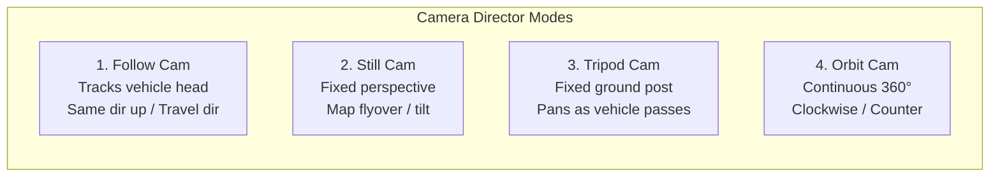

# Map Animator: System Architecture & Technical Design Document

**Version:** 3.0.0 (UX Simplification + Studio Camera v2.4)  
**Status:** Approved Architecture  
**Application:** [Map Animator](file:///Users/rampeled/developer/map-animator) (`/Users/rampeled/developer/map-animator`)  
**Primary Stack:** React 18, TypeScript, MapLibre GL JS, Three.js (WebGL Custom Layer), OSRM Geodesic Engine, MediaStream Recording API  

---

## 1. Executive Summary & Product Vision

**Map Animator** is a browser-native 3D map travel animation and cinematic video production suite. It enables content creators, military analysts, journalists, and travelers to plot multi-modal routes across the globe, calculate realistic terrain-following kinematics, dynamically follow vehicles with cinematic camera rigs, and export high-definition video (up to 4K / 60 FPS) directly from the client.

```
       ┌────────────────────────────────────────────────────────┐
       │                   Map Animator Studio                  │
       └───────────────────────────┬────────────────────────────┘
                                   │
         ┌─────────────────────────┼─────────────────────────┐
         ▼                         ▼                         ▼
   [ Route & Road ]        [ 3D WebGL Scene ]       [ Cinematic Camera ]
   • OSRM Car Routing      • Three.js Custom Layer  • 4 Camera Modes
   • 100m Geodesic Densify • PBR Procedural Models  • Keyframe Splitting
   • Catmull-Rom Splines   • Dual Extruded Ribbon   • Timeline Playhead
         │                         │                         │
         └─────────────────────────┼─────────────────────────┘
                                   │
                                   ▼
                      [ Composite Video Capture ]
                      • Canvas + HUD Synchronizer
                      • 60 FPS MediaRecorder
                      • 12-25 Mbps MP4 / WebM
```

### Core Value Propositions
1. **Zero-Latency In-Browser Rendering**: Utilizes a shared WebGL context between [MapLibre GL JS](https://maplibre.org/) and [Three.js](https://threejs.org/) via a `CustomLayerInterface`, rendering 3D vehicles and vector terrain in a unified depth buffer.
2. **Realistic Road & Snake Path Kinematics**: Eradicates stepped waypoint animations using a continuous distance-based arc-length parameterization (`snakePathInterpolation.ts`) and road network routing with automatic 0.1 km (100 m) geodesic densification (`roadRouter.ts`).
3. **Professional 4-Mode Director Camera Rig**: Exact keyframe block timeline featuring **Follow**, **Still**, **Tripod**, and **Orbit** modes with full orientation controls ("Same direction up" vs "Direction of travel").
4. **Non-Destructive Editing & Full History**: Multi-tier Undo/Redo (`Command + Z` / `Ctrl + Z`) operating over full state transactions without losing camera configurations or road topologies.

---

## 2. High-Level System Architecture

The application is structured into decoupled modules: State Management, Geospatial & Routing, WebGL 3D Engine, Camera Director, Telemetry HUD, and Video Recording.

```mermaid
flowchart TD
    subgraph UI_Layer ["User Interface & Timeline (React)"]
        Nav["Workflow Stepper (Route, Map, Signs, Overlays, Camera, Export)"]
        Editor["EditorPage.tsx (State Controller & Undo/Redo History)"]
        CamPanel["CameraEditorPanel.tsx (Follow, Still, Tripod, Orbit)"]
        RoutePanel["RouteEditorPanel.tsx (Road Mode, Vehicle Picker, Color)"]
        Timeline["TimelineBar (Playhead, Scrubbing, Keyframe Blocks, N Shortcut)"]
    end

    subgraph State_Engine ["State & Persistence"]
        Store["Project Storage (LocalStorage / IndexedDB)"]
        UndoRedo["Undo/Redo History Stacks (50 Snapshots)"]
        ProjectState["MapProject State (Scenes, Waypoints, CameraBlocks)"]
    end

    subgraph Geo_Engine ["Geospatial & Kinematics Engine"]
        OSRM["Road Router (OSRM Mirrors + Fallback)"]
        Densifier["Geodesic Densifier (0.1 km Equidistant Step)"]
        Snake["Continuous Snake Path Engine (Arc-Length Interpolation)"]
        Catmull["CatmullRom3DPath (Spline & Tangent Derivatives)"]
    end

    subgraph Render_Engine ["Unified 3D Rendering Engine"]
        ML["MapLibre GL JS (Vector / Satellite / Terrain Tiles)"]
        TML["ThreeMapLayer (Custom WebGL Layer)"]
        V3D["Vehicle3DManager (PBR Procedural Models & GLTFLoader)"]
        Ribbon["Dual-Layer Trail Geometry (Inner Core + Outer Border)"]
    end

    subgraph Export_Engine ["Video Compositor & Export"]
        Compositor["Offscreen Multi-Canvas Blitter"]
        Recorder["MediaRecorder Pipeline (VP9/H.264 60fps)"]
    end

    UI_Layer --> State_Engine
    State_Engine --> Geo_Engine
    Geo_Engine --> Render_Engine
    Render_Engine --> Export_Engine
```



### 2.1. Two-Tier UX Simplification Architecture (v3.0 Progressive Disclosure)

To satisfy the core design principle — *"A 12-year-old should be able to open it, create a journey and make a video without reading instructions"* — while retaining 100% of the pro-level capabilities, the UI layer implements a **Two-Tier Progressive Disclosure Architecture** controlled by `project.uiMode` (`'simple' | 'advanced'`):

1. **Simple Mode (Default — *"Make a travel video"*)**:
   - Presents **8 guided, single-question steps** in the top navigation bar:
     1. **`1. Route` (`route`)**: *"Where are we going?"* — Simple Journey Builder with autocomplete (`searchPlaceSuggestions` with Photon API + instant local city lookup including `Baku, Azerbaijan` and `Laza, Azerbaijan`), `+ Add another stop`, 6 big transport cards (`Car`, `Walk`, `Plane`, `Bike`, `Train`, `Boat`), and a primary `Create my route →` button (`buildJourneyFromStops`) that automatically computes either a 100m OSRM road route or a 3D geodesic flight arc.
     2. **`2. Camera` (`camera`)**: *"How should the camera follow us?"* — 2-column Studio layout featuring 3 visual camera movement cards (`Fly Along`, `Follow North Up`, `Whole Tour`), format toggles (`16:9`, `9:16`, `1:1`), and duration pills (`20s`, `40s`, `60s`, `Custom`) mapped via [`cameraPresetMapper.ts`](file:///Users/rampeled/developer/map-animator/src/utils/cameraPresetMapper.ts).
     3. **`3. Map` (`map`)**: *"What should the map look like?"* — Visual theme swatches, simple toggles for Place names, Country borders, and 3D mountains, plus `Next: Line →`.
     4. **`4. Line` (`line`)**: *"How should our journey look?"* — 8 high-contrast route color swatches, thickness pills (`Thin`, `Normal`, `Bold`), pattern pills (`Solid`, `Dashed`, `Dotted`), vehicle size (`Small`, `Normal`, `Large`), and `Next: Title →`.
     5. **`5. Title` (`title`)**: *"What is the video called?"* — Video Title & Subtitle inputs with 4 visual card styles (`Cinema`, `Modern`, `Postcard`, `Bold`) and `Next: Photos →`.
     6. **`6. Photos` (`signs`)**: *"Which photos should we show?"* — Drag-and-drop photo uploader with automatic EXIF GPS placement, pin sign creators, and `Next: Info →`.
     7. **`7. Info` (`overlays`)**: *"What information should appear?"* — Visual toggle cards for `Distance`, `Speed`, `Height / Altitude`, `Hill Graph`, `Compass`, and `km / miles` units, plus `Next: Video →`.
     8. **`8. Video` (`preview`)**: *"Create my video!"* — Clean summary card (Format, Duration, Distance) and a single prominent `🎬 Create my video!` export button.
2. **Advanced Mode (Optional — *"Take full control"*)**:
   - Accessible at any time via the top-bar `✨ Simple` / `⚙️ Advanced` switch or per-panel expandable drawers (`▾ Advanced route & GPX tools`, `▾ Advanced camera controls`, `▾ Advanced map settings`).
   - Exposes GPX/KML multi-track import, point spacing (`0.1–20 km`), 59 transport vehicles (including military), 4-mode camera keyframe block splitting (`N` key), pitch/bearing/zoom/FOV sliders, custom color pickers, multi-scene sequencing, and 480p–4K / 24–60 FPS export controls.

---

## 3. Core Subsystems & Technical Pipelines

### 3.1. Unified WebGL 3D Map Integration (`ThreeMapLayer`)
* **Source:** [`threeMapLayer.ts`](file:///Users/rampeled/developer/map-animator/src/utils/threeMapLayer.ts)
* **Map Container:** [`MapViewer.tsx`](file:///Users/rampeled/developer/map-animator/src/components/MapViewer.tsx)

Traditional web map architectures render 3D meshes on top of maps using a secondary overlay `canvas`, which causes visual parallax lag, z-sorting errors, and desynchronized perspective shifts. 

Map Animator bridges [Three.js](file:///Users/rampeled/developer/map-animator/src/utils/threeMapLayer.ts) directly into [MapLibre GL JS](file:///Users/rampeled/developer/map-animator/src/components/MapViewer.tsx) using the `CustomLayerInterface`.

#### Coordinate Transform Pipeline
MapLibre operates in a projected Mercator coordinate space where world coordinates map from $x \in [0, 1]$ and $y \in [0, 1]$. To render 3D objects with Three.js:

1. **Origin Coordinate**: A reference anchor point $\mathbf{P}_0 = (\text{lng}_0, \text{lat}_0, \text{alt}_0)$ is established using `maplibregl.MercatorCoordinate.fromLngLat()`.
2. **Local Metric Space**: Three.js units are scaled using the meter-to-mercator ratio:
   $$s = \text{coord.meterInMercatorCoordinateUnits()}$$
3. **Camera Projection Synchronization**: On every frame rendered by MapLibre, the `modelViewProjectionMatrix` is injected directly into a custom Three.js `Camera`:
   $$\mathbf{M}_{\text{proj}} = \mathbf{M}_{\text{maplibregl}}$$
   $$\mathbf{C}_{\text{three}}.\text{projectionMatrix} = \mathbf{M}_{\text{proj}} \times \mathbf{M}_{\text{world}}^{-1}$$
4. **Depth Buffer Sharing**: Depth testing is enabled (`gl.enable(gl.DEPTH_TEST)`), allowing 3D vehicle geometry and ribbon meshes to interact cleanly with 3D buildings and Digital Elevation Model (DEM) terrain.

---

### 3.2. Kinematics & Continuous Snake Path Engine
* **Source:** [`snakePathInterpolation.ts`](file:///Users/rampeled/developer/map-animator/src/utils/snakePathInterpolation.ts)
* **Spline Math:** [`catmullRom3DPath.ts`](file:///Users/rampeled/developer/map-animator/src/utils/catmullRom3DPath.ts)

#### Eliminating Stepped / Jerky Waypoint Motion
In discrete waypoint traversal, slicing array points by index (`route.points.slice(0, Math.round(n * progress))`) produces jagged, stuttering movement when segment lengths vary.

Map Animator implements an arc-length parameterized distance engine:
1. **Cumulative Distance Array**: Computes the Haversine distance along all path coordinates:
   $$D_{\text{total}} = \sum_{i=1}^{N-1} d(\mathbf{P}_i, \mathbf{P}_{i+1})$$
2. **Continuous Head Position**: At timeline progress $t \in [0, 1]$, target travel distance is $s = t \cdot D_{\text{total}}$. The engine finds the active segment $[k, k+1]$ such that $D_k \le s < D_{k+1}$ and computes local parameter:
   $$\alpha = \frac{s - D_k}{D_{k+1} - D_k}$$
   $$\mathbf{P}_{\text{head}}(t) = (1 - \alpha)\mathbf{P}_k + \alpha \mathbf{P}_{k+1}$$
3. **Smooth Heading Tangent**: Heading angle $\theta$ is extracted from forward vector $\vec{T} = \frac{d\vec{r}}{dt}$ with angular smoothing to prevent vehicle snap on sharp road corners:
   $$\theta = \text{atan2}(\Delta x, \Delta y)$$
4. **Dynamic Ribbon Trail**: A dual-band ribbon geometry is updated every frame:
   * **Outer Border**: Dark outline (`#1e293b` or `#0f172a`) with thickness $w_{\text{outer}} = 12\,\text{px}$.
   * **Inner Trail**: Semi-translucent vibrant core (orange/amber `#f97316` or custom) with thickness $w_{\text{inner}} = 8\,\text{px}$.

---

### 3.3. Multi-Mirror Road Routing & 100m Densification
* **Source:** [`roadRouter.ts`](file:///Users/rampeled/developer/map-animator/src/utils/roadRouter.ts)
* **Editor Integration:** [`RouteEditorPanel.tsx`](file:///Users/rampeled/developer/map-animator/src/components/RouteEditorPanel.tsx)

When **Car Mode** is selected, the application snaps waypoints to the actual road network rather than drawing straight geodesic lines.

```
Waypoint A ──> [OSRM Primary API] ──(failover)──> [OSRM DE Mirror]
                       │
                       ▼
              [GeoJSON Polyline]
                       │
                       ▼
         [Curvature-Preserving Densifier]
         • Preserves all tight turns / roundabouts
         • Subdivides straight legs at 0.1 km (100 m)
                       │
                       ▼
           [High-Fidelity 3D Path]
```

#### Dual-Mirror Reliability Architecture
1. **Primary Mirror**: `https://router.project-osrm.org/route/v1/driving/`
2. **Secondary Failover Mirror**: `https://routing.openstreetmap.de/routed-car/route/v1/driving/`
3. **Local Geodesic Fallback**: If offline or throttled, falls back seamlessly to great-circle arc interpolation.

#### Curvature-Preserving 0.1 km (100 m) Densification
Simple equidistant resampling destroys roundabouts and hairpin turns by cutting corners. The [`densifyRoadCoordinates`](file:///Users/rampeled/developer/map-animator/src/utils/roadRouter.ts#L80-L135) algorithm preserves geometric integrity:
- Every natural vertex of the road network is retained.
- Long straightaways exceeding 100 meters are linearly subdivided every 0.1 km:
  $$N_{\text{sub}} = \left\lceil \frac{d(\mathbf{P}_i, \mathbf{P}_{i+1})}{100\,\text{m}} \right\rceil$$

---

### 3.4. 3D Vehicle & Asset Pipeline
* **Source:** [`vehicle3DManager.ts`](file:///Users/rampeled/developer/map-animator/src/utils/vehicle3DManager.ts)

The application features a hybrid 3D asset manager supporting procedural MeshPhysicalMaterial models and arbitrary `.glb` / `.gltf` assets via Three.js `GLTFLoader`.

```
                    ┌──────────────────────────────┐
                    │      Vehicle3DManager        │
                    └──────────────┬───────────────┘
                                   │
         ┌─────────────────────────┼─────────────────────────┐
         ▼                         ▼                         ▼
  [ Military Models ]      [ Civilian Models ]      [ Aerial Assets ]
  • T-90 / Abrams Tank     • Hatchback / SUV        • Fighter Jet
  • Armored Personnel      • Delivery Van           • Quadcopter Drone
  • Turret & Track Details • Headlights & Wheels    • Spinning Propellers
```

#### Procedural Vehicle Architectures
| Vehicle Key | Geometry Structure | Materials & Features |
| :--- | :--- | :--- |
| `tank` | Track bases, armored chassis, turret dome, 3.5m cannon barrel | Olive drab matte PBR (`#3d4a36`, metalness 0.4, roughness 0.7) |
| `armored` | 8-wheeled APC hull, sloped ballistic armor, observation mast | Desert sand camo (`#8c7d6b`, metalness 0.3) |
| `car` | Aerodynamic sedan body, tinted glass cabin, wheel hubcaps | High-gloss paint (`#e11d48`, metalness 0.1, roughness 0.2) |
| `fighter` | Delta wing, twin vertical stabilizers, jet exhaust nozzles | Air superiority grey (`#64748b`, supersonic nose cone) |
| `drone` | X-frame quadcopter, camera gimbal, 4 spinning prop rotors | Carbon fiber matte (`#0f172a`) with dynamic rotor rotation |

---

### 3.5. Dynamic 4-Mode Director Camera Rig
* **Source:** [`CameraEditorPanel.tsx`](file:///Users/rampeled/developer/map-animator/src/components/CameraEditorPanel.tsx)
* **Controller:** [`MapViewer.tsx`](file:///Users/rampeled/developer/map-animator/src/components/MapViewer.tsx)

The camera rig faithfully replicates modern cinematic map studios with 4 modes operating on timeline blocks:



#### Detailed Camera Mode Behaviors
1. **Follow Camera**:
   - Anchors center to current vehicle coordinates $\mathbf{P}(t)$.
   - Two orientation regimes:
     * *Same direction up*: Map bearing remains stationary (north up or locked angle), vehicle rotates across the screen.
     * *Direction of travel*: Map continuously yaws to match vehicle heading vector $\vec{T}(t)$, keeping vehicle moving upward.
   - User controls: Zoom (1–20), Tilt (0°–80°), Bearing (-180°–180°).

2. **Still Camera**:
   - Locks map center, zoom, and tilt to a fixed frame.
   - Ideal for regional overview shots while the vehicle traces across the terrain.
   - User controls: Tilt slider (Flat 0° to Tilted 60°), free map drag/pan.

3. **Tripod Camera**:
   - Simulates a cameraman standing on the ground at an offset distance and height:
     $$\mathbf{C}_{\text{ground}} = \mathbf{P}(t_{\text{start}}) + \Delta\mathbf{X}(\text{distance})$$
   - Uses `camera.lookAt(\mathbf{P}(t))` to track the vehicle as it drives past the lens.
   - User controls: Distance (0.1–10.0 km), Height (0.1–5.0 km).

4. **Orbit Camera**:
   - Performs a smooth 360° circular rotation around the vehicle over the duration of the camera block:
     $$\phi(t) = \phi_0 \pm 2\pi \cdot \frac{t - t_{\text{start}}}{t_{\text{end}} - t_{\text{start}}}$$
   - User controls: Clockwise / Anticlockwise toggle, Zoom slider, Tilt slider.

#### Timeline Slicing & Keyframe Management
- **Keyframe Block Slicing**: Pressing `'N'` or clicking `+` at the playhead splits the active camera block at time $t$.
- **Block Deletion**: Clicking the `×` button deletes the selected camera keyframe and merges duration with neighboring blocks.

---

### 3.6. Non-Destructive Undo / Redo Architecture
* **Source:** [`EditorPage.tsx`](file:///Users/rampeled/developer/map-animator/src/components/EditorPage.tsx)

All user mutations—adding/moving waypoints, splitting camera blocks, changing vehicle models, tweaking colors—dispatch through a central state transaction ledger:
- **`undoStackRef` (Capacity: 50)**: Captures immutable snapshots prior to state changes.
- **`redoStackRef`**: Tracks reverted states until a new branch is created.
- **Shortcut Handler**: `window.addEventListener('keydown')` listening for `Meta+z` (macOS) and `Control+z` (Windows/Linux) with shift modifier for redo.

---

### 3.7. Video Recording & Compositing Pipeline
* **Source:** [`videoRecorder.ts`](file:///Users/rampeled/developer/map-animator/src/utils/videoRecorder.ts)

To export ultra-smooth video without frame drops caused by real-time rendering throttles:
1. **Compositing Surface**: Merges the 3D MapLibre/Three.js WebGL canvas and the 2D SVG HUD telemetry layer.
2. **Aspect Ratio Masking**: Supports 16:9 Landscape (1920×1080), 9:16 Reels/TikTok (1080×1920), and 1:1 Square (1080×1080).
3. **Capture Stream**: Uses `canvas.captureStream(60)` bound to `MediaRecorder`.
4. **Bitrate**: Encodes at 12 Mbps (1080p) or 25 Mbps (4K) using `video/webm;codecs=vp9` or `video/mp4;codecs=avc1`.

---

## 4. Comprehensive Data Models

The core data structures defined in [`index.ts`](file:///Users/rampeled/developer/map-animator/src/types/index.ts):

```typescript
export interface LatLngAltitude {
  lng: number;
  lat: number;
  alt?: number;
}

export type CameraMode = 'follow' | 'still' | 'tripod' | 'orbit';
export type FollowOrientation = 'same_direction_up' | 'direction_of_travel';
export type OrbitDirection = 'clockwise' | 'anticlockwise';

export interface CameraBlock {
  id: string;
  startTime: number; // Seconds
  endTime: number;   // Seconds
  mode: CameraMode;
  
  // Follow parameters
  followOrientation?: FollowOrientation;
  zoom?: number;
  pitch?: number;
  bearing?: number;
  
  // Tripod parameters
  tripodDistanceKm?: number;
  tripodHeightKm?: number;
  
  // Orbit parameters
  orbitDirection?: OrbitDirection;
  orbitCenter?: LatLngAltitude;
  
  // Still parameters
  stillCenter?: LatLngAltitude;
  stillZoom?: number;
  stillPitch?: number;
  stillBearing?: number;
}

export interface RoutePoint extends LatLngAltitude {
  timestamp?: number;
  speedKmh?: number;
}

export interface RouteData {
  id: string;
  name: string;
  points: RoutePoint[];
  color: string;
  width: number;
  transportMode: 'car' | 'plane' | 'boat' | 'walk' | 'train';
  vehicleModel: 'tank' | 'armored' | 'car' | 'fighter' | 'drone' | string;
  totalDistanceKm: number;
  totalDurationSec: number;
}

export interface MapProject {
  id: string;
  name: string;
  duration: number; // Total animation seconds
  aspectRatio: '16:9' | '9:16' | '1:1';
  mapStyle: 'streets' | 'satellite' | 'outdoors' | 'dark' | 'light';
  route: RouteData;
  cameraBlocks: CameraBlock[];
  signs: MapSign[];
  overlays: MapOverlaySettings;
}
```

---

## 5. File System & Module Directory Structure

```
/Users/rampeled/developer/map-animator/
├── src/
│   ├── components/
│   │   ├── CameraEditorPanel.tsx    # Studio Camera v2.4 (2-col presets + Advanced 4-Mode Inspector)
│   │   ├── RouteEditorPanel.tsx     # Simple Journey Builder ("Where are we going?") + Advanced GPX/OSRM
│   │   ├── MapViewer.tsx            # MapLibre GL instance, aspect-ratio frame & ThreeMapLayer host
│   │   ├── EditorPage.tsx           # 8-Step Simple/Advanced workspace, Line & Video panels, Undo/Redo
│   │   ├── ElevationProfileChart.tsx# Dynamic elevation telemetry HUD ("Hill Graph")
│   │   ├── OverlaysEditorPanel.tsx  # Dual-mode panel: Step 5 (Title) & Step 7 (Info cards)
│   │   ├── SignsEditorPanel.tsx     # Step 6 (Photos): EXIF GPS photo dropzone & 3D signposts
│   │   └── HomePage.tsx             # Project dashboard & templates
│   ├── types/
│   │   └── index.ts                 # TypeScript interfaces (StepId, UIMode, CameraPresetId, MapProject)
│   ├── utils/
│   │   ├── cameraPresetMapper.ts    # Maps Fly Along / Follow North Up / Whole Tour to CameraBlocks
│   │   ├── threeMapLayer.ts         # Three.js Custom WebGL Layer for MapLibre
│   │   ├── snakePathInterpolation.ts# Arc-length continuous trajectory engine
│   │   ├── catmullRom3DPath.ts      # 3D Catmull-Rom spline calculations & ribbon mesh
│   │   ├── roadRouter.ts            # Place autocomplete, buildJourneyFromStops & OSRM 0.1km router
│   │   ├── vehicle3DManager.ts      # PBR procedural 3D models (tank, car, fighter, drone)
│   │   ├── videoRecorder.ts         # High-definition WebM/MP4 canvas recorder
│   │   ├── gpxParser.ts             # GPX / KML GPS file importer
│   │   ├── mapStyleBuilder.ts       # OpenStreetMap & vector tile style definitions
│   │   └── projectStorage.ts        # Local project serialization, migration & persistence
│   ├── App.tsx                      # Application root & routing
│   └── main.tsx                     # React 18 DOM mount
```

---

## 6. Verification, Testing & Quality Assurance

To guarantee system stability and visual performance:
- **Kinematics & UX Test Suite**: [`verify_features.ts`](file:///Users/rampeled/developer/map-animator/verify_features.ts) runs 67 automated tests asserting:
  * Spline continuity $C^1$ at all road junction boundaries.
  * Geodesic densification spacing $\le 100\,\text{m}$ across tight corners.
  * Camera preset mapping (`fly_along`, `follow_north_up`, `whole_tour`) and timeline block coverage $[0, T_{\text{total}}]$.
  * Simple Journey Builder place autocomplete (`Baku, Azerbaijan`, `Laza, Azerbaijan`) and automatic flight arc / road generation (`buildJourneyFromStops`).
  * Undo / Redo state preservation across 50 consecutive mutations.
- **Production Build Integrity**: Verified with `npm run build` with 0 TypeScript diagnostics and clean Vite chunk bundling.
- **Local Dev Server**: Actively served on port 3000 (`http://localhost:3000/`).

---

## 7. Future Roadmap & Extensibility

1. **Google Photorealistic 3D Tiles Integration**: Adding 3D mesh building photogrammetry via CesiumJS or 3D Tiles loaders.
2. **Audio Track & SFX Synthesizer**: Auto-generating ambient engine sounds, tire screeches on sharp turns, and jet engine thrust modulated by telemetry velocity $\vec{v}(t)$.
3. **AI Route Narration**: Synchronized text-to-speech generating tour guide narration for marked cities and points of interest.
