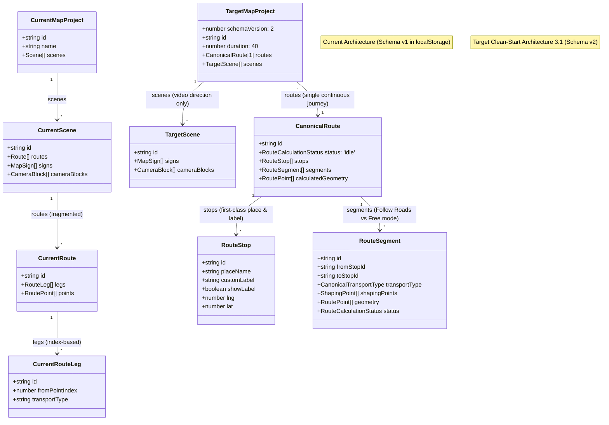

# Phase 1 Architecture Audit – Map Animator (Clean-Start Architecture)

**Repository:** `map-animator`  
**Working Directory:** `/Users/rampeled/developer/map-animator`  
**Generated:** 2026-11-11T12:26:00+02:00  
**Baseline References:** Architecture 3.1 (`Map_Animator_Architecture_3.1.md`), Map Animator v4.0.0 Specification, Approved Clean-Start Decision.

---

## 1. Executive Summary & Product Decision

### Approved Product Decision: Clean Start, No Legacy Migration
The product owner has explicitly approved a complete **Clean Start**. All legacy Map Animator project data is deprecated and will be decommissioned. 

**Zero Legacy Migration:**
- No legacy route migration or route conversion.
- No route stitching, spatial continuity heuristics, or primary-route selection.
- No secondary-route quarantine or diagnostic payloads.
- No legacy `.mapanim` backward-compatibility layer.
- No legacy recovery fallbacks.

The application starts fresh with an empty local-first IndexedDB project store built strictly upon the approved canonical data model (Schema v2).

---

## 2. Verified Current Repository Architecture (Schema v1 Baseline)

### 2.1 Actual Current Storage Implementation
Inspection of `src/App.tsx` and `src/utils/projectStorage.ts` establishes the current runtime baseline:
- **Persistence Driver:** `localStorage` directly via `localStorage.getItem('mapanimator_projects_v1')` and `localStorage.setItem('mapanimator_projects_v1', JSON.stringify(projects))`.
- **IndexedDB Reality:** `idb` is declared in `package.json` (`^8.0.2`), but is not currently initialized or invoked in runtime source code.
- **Project Structure:** Projects are held in an array in React state (`projects: MapProject[]`) and flushed on every state change into `localStorage`.
- **Export/Import:** `src/utils/projectStorage.ts` exports raw JSON as `.mapanim`.

### 2.2 Current TypeScript Interfaces (For Reference)
```typescript
export interface RoutePoint {
  lng: number;
  lat: number;
  ele?: number;
  time?: number;
  pauseSec?: number;
  sharpCorner?: boolean;
}

export interface RouteLeg {
  id: string;
  fromPointIndex: number; // Array index into Route.points
  transportType: TransportType; // 59 legacy enum values
  use3dSymbol: boolean;
  color?: string;
  lineStyle?: 'solid' | 'dashed' | 'dotted';
}

export interface Route {
  id: string;
  name: string;
  color: string;
  width: number;
  style: 'solid' | 'dashed' | 'dotted';
  transportType?: TransportType;
  hideLine?: boolean;
  symbolScale?: number;
  startOffsetSec?: number;
  legs: RouteLeg[];
  points: RoutePoint[];
  stats?: RouteStats;
}

export interface Scene {
  id: string;
  name: string;
  duration: number;
  holdStartSec: number;
  holdEndSec: number;
  mapThemeId: string;
  mapLabels?: boolean;
  labelLang?: string;
  regions?: boolean;
  terrain?: boolean;
  camera?: SceneCamera;
  routes: Route[]; // Multi-route nested array
  signs: MapSign[];
  cameraBlocks: CameraBlock[];
  overlays: OverlayConfig;
}

export interface MapProject {
  id: string;
  name: string;
  createdAt: number;
  updatedAt: number;
  uiMode?: UIMode;
  aspect: '16:9' | '9:16' | '1:1' | '4:5' | '4:3' | '21:9';
  aspectRatio?: AspectRatioOption;
  duration?: number;
  cameraPreset?: CameraModePreset;
  cameraSettings?: CameraSettings;
  durationPreset?: DurationPreset;
  size: 480 | 720 | 1080 | 1440 | 2160;
  fps: 24 | 25 | 30 | 50 | 60;
  includeMapCredit?: boolean;
  scenes: Scene[];
}
```

---

## 3. Approved Schema v2 Target Architecture

### 3.1 Core Architecture Principles
1. **Single Canonical Journey:** Exactly one continuous route per project, located at `MapProject.routes` (an array strictly validated to `length === 1`).
2. **First-Class Destination Stops:** Distinct from calculated coordinates. Persists place name, editable display label, coordinates, place identifier, and label visibility.
3. **Structured Segments & Routing Engines:**
   - **Follow Roads (OSRM):** Applies exclusively to `car`, `walking`, and `bike`.
   - **Free Mode (Direct / Arc Geometry):** Applies to `train`, `boat`, and `plane`.
4. **Scenes Retain Video Direction Only:** Scenes hold camera blocks, duration, signs, and overlay visibility for timeline pacing; scenes have **no** route ownership.
5. **Strict 6-Mode Transport Engine:** Only `car`, `walking`, `bike`, `train`, `boat`, and `plane`.
6. **Clean Target Schema:** No legacy migration diagnostic fields (`migrationDiagnostics`, `unconvertedPayload`) exist in Schema v2.

### 3.2 Approved Target TypeScript Interfaces
```typescript
export type CanonicalTransportType = 
  | 'car' 
  | 'walking' 
  | 'bike' 
  | 'train' 
  | 'boat' 
  | 'plane';

export type RouteCalculationStatus = 
  | 'idle' 
  | 'calculating' 
  | 'calculated' 
  | 'stale' 
  | 'error';

export interface RouteStop {
  id: string;
  placeName: string; // Actual resolved location / place name
  customLabel: string; // User-editable display label
  showLabel: boolean; // Label visibility on map (default true)
  lng: number;
  lat: number;
  ele?: number;
  placeId?: string;
  query?: string;
}

export interface ShapingPoint {
  id: string;
  lng: number;
  lat: number;
  ele?: number;
}

export interface RoutePoint {
  lng: number;
  lat: number;
  ele?: number;
  time?: number;
  pauseSec?: number;
  sharpCorner?: boolean;
}

export interface RouteSegment {
  id: string;
  fromStopId: string;
  toStopId: string;
  transportType: CanonicalTransportType;
  routingProfile?: 'driving' | 'cycling' | 'foot' | 'direct';
  shapingPoints: ShapingPoint[];
  use3dSymbol: boolean;
  color?: string;
  lineStyle?: 'solid' | 'dashed' | 'dotted';
  status: RouteCalculationStatus;
  distanceMeters?: number;
  durationSeconds?: number;
  geometry: RoutePoint[];
  errorMessage?: string;
}

export interface RouteStats {
  distanceKm: number;
  elevationGainM?: number;
  elevationLossM?: number;
  minEleM?: number;
  maxEleM?: number;
  durationSec?: number;
  avgSpeedKmh?: number;
}

export interface CanonicalRoute {
  id: string;
  name: string;
  status: RouteCalculationStatus; // Route-level calculation status
  color: string;
  width: number;
  style: 'solid' | 'dashed' | 'dotted';
  hideLine?: boolean;
  symbolScale?: number;
  startOffsetSec?: number;
  stops: RouteStop[];
  segments: RouteSegment[];
  calculatedGeometry: RoutePoint[];
  stats?: RouteStats;
}

export interface MapSign {
  id: string;
  lng: number;
  lat: number;
  style: 'pin' | 'text' | 'photo' | 'roadSign' | 'camp' | 'start' | 'finish' | 'hotel';
  text: string;
  photoUrl?: string;
  triggerMode: 'always' | 'onPassed' | 'whilePassing';
  pauseSec?: number;
  size: number;
}

export interface CameraBlock {
  id: string;
  tRatio: number;
  kind: 'still' | 'follow' | 'tripod' | 'orbit';
  center: [number, number];
  zoom: number;
  pitch: number;
  bearing: number;
  followOrient?: 'north' | 'heading';
  rotateOffset?: number;
  distanceKm?: number;
  heightKm?: number;
  orbitDirection?: 'clockwise' | 'anticlockwise';
  easing?: 'linear' | 'easeInOutQuad' | 'smooth';
}

export interface OverlayConfig {
  title?: string;
  subtitle?: string;
  showDistance: boolean;
  showAltitude: boolean;
  showSpeed: boolean;
  showClimbDescent?: boolean;
  showElevationProfile: boolean;
  showCompass: boolean;
  unit: 'metric' | 'imperial' | 'nautical';
  theme: 'dark' | 'light' | 'vintage' | 'minimal' | 'bold' | 'outdoor';
}

export interface SceneCamera {
  center: [number, number];
  zoom: number;
  bearing: number;
  pitch: number;
  rotateOffset?: number;
}

export interface Scene {
  id: string;
  name: string;
  duration: number;
  holdStartSec: number;
  holdEndSec: number;
  mapThemeId: string;
  mapLabels?: boolean;
  labelLang?: string;
  regions?: boolean;
  terrain?: boolean;
  camera?: SceneCamera;
  signs: MapSign[];
  cameraBlocks: CameraBlock[];
  overlays: OverlayConfig;
  // Scene.routes is completely removed
}

export type AspectRatioOption = '16:9' | '9:16' | '1:1';
export type DurationPreset = 20 | 40 | 60 | 'custom';
export type CameraModePreset = 'fly_along' | 'follow_north_up' | 'whole_tour';

export interface CameraSettings {
  preset: CameraModePreset;
  zoom?: number;
  pitch?: number;
  bearing?: number;
  smoothness?: number;
}

export interface MapProject {
  schemaVersion: 2;
  id: string;
  name: string;
  createdAt: number;
  updatedAt: number;
  uiMode?: 'simple' | 'advanced';
  aspect: '16:9' | '9:16' | '1:1' | '4:5' | '4:3' | '21:9';
  aspectRatio?: AspectRatioOption;
  duration: number; // Defaults to 40s to align with durationPreset
  cameraPreset?: CameraModePreset;
  cameraSettings?: CameraSettings;
  durationPreset?: DurationPreset; // Defaults to 40
  size: 480 | 720 | 1080 | 1440 | 2160;
  fps: 24 | 25 | 30 | 50 | 60;
  includeMapCredit?: boolean;
  routes: [CanonicalRoute]; // Strictly 1 canonical route
  scenes: Scene[];
}
```

---

## 4. Current vs Target Architecture Comparison



---

## 5. IndexedDB Target Storage Architecture

### 5.1 Database Specifications
- **Database Name:** `map_animator_db`
- **Database Version:** `1`
- **Library:** `idb` (v8.0.2).

### 5.2 Target Object Store Architecture
| Object Store | Primary Key (`keyPath`) | Indices | Contents / Description |
| :--- | :--- | :--- | :--- |
| **`projects`** | `id` (string) | `by_updatedAt` (`updatedAt`) | Stores canonical `MapProject` documents (Schema v2). |
| **`assets`** | `id` (string) | `by_projectId` (`projectId`) | Stores binary media blobs (photo callouts, custom icons, audio tracks). |
| **`backups`** | `id` (string) | `by_projectId` (`projectId`), `by_createdAt` (`createdAt`) | Stores complete compressed snapshot recovery points (project document + all associated assets) created prior to destructive bulk actions. |
| **`deviceInfo`** | `key` (string) | None | Stores per-browser/device UUID and device-local Home View settings. |

---

## 6. Component & Storage Dependency Analysis

### 6.1 Reusable Core Engines
| Component / Engine | Source File | Corrected Behavioral Contract |
| :--- | :--- | :--- |
| **MapLibre GL Map Engine** | `src/components/MapViewer.tsx` | Reused directly. Reads path ribbon from `project.routes[0].calculatedGeometry`. |
| **Three.js Layer** | `src/components/MapViewer.tsx` | Reused directly. Vehicles render from active segment transport mode. |
| **Road Router Engine** | `src/utils/roadRouter.ts` | **OSRM Follow Roads applies exclusively to `car`, `walking`, and `bike`. `train`, `boat`, and `plane` utilize Free mode with direct/geodesic geometry.** |
| **Spline / Arc Engine** | `src/utils/catmullRom3DPath.ts` | Reused directly for continuous animation and flight arcs. |
| **Telemetry & HUD** | `src/components/ElevationProfileChart.tsx` | Reused directly. Computes stats from canonical geometry. |

### 6.2 Architectural Gaps & Implementation Requirements
1. **Replace `localStorage` with `ProjectStorage`:** Migrate all project persistence calls in `src/App.tsx` and `src/utils/projectStorage.ts` to the async IndexedDB store interface.
2. **Refactor `RouteEditorPanel.tsx`:** Remove local React state stop arrays (`JourneyStop[]`) and bind directly to `project.routes[0].stops` and `project.routes[0].segments`.
3. **Restrict Transport Selectors:** Replace the 59-transport catalog in `RouteEditorPanel` with the approved 6 canonical modes: `car`, `walking`, `bike`, `train`, `boat`, `plane`.
4. **Remove Scene Route Bindings:** Remove all references to `scene.routes` in UI and state selectors.
5. **Enforce Single Route Invariant:** Add runtime validation to prevent adding or creating more than one route per project.

---
*Clean-Start Architecture Audit finalized for Phase 1.*
